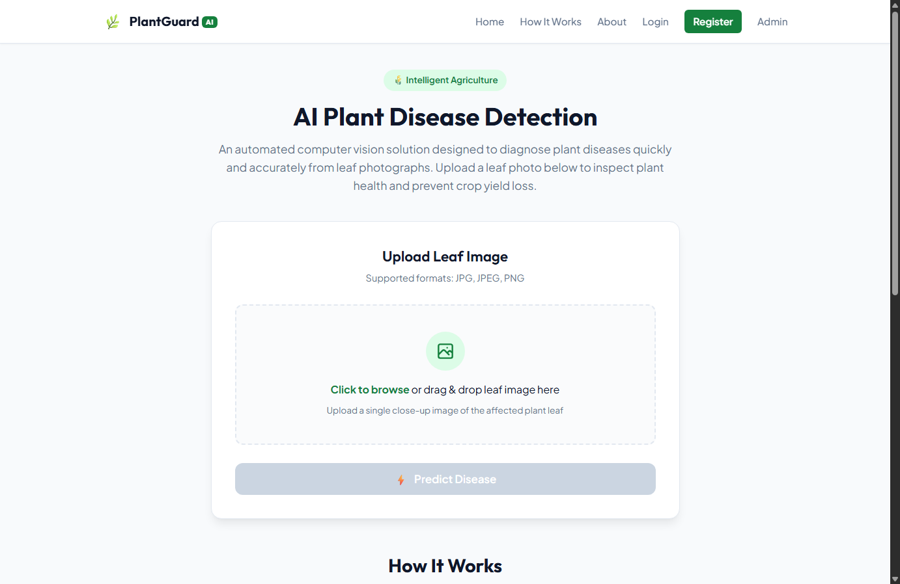
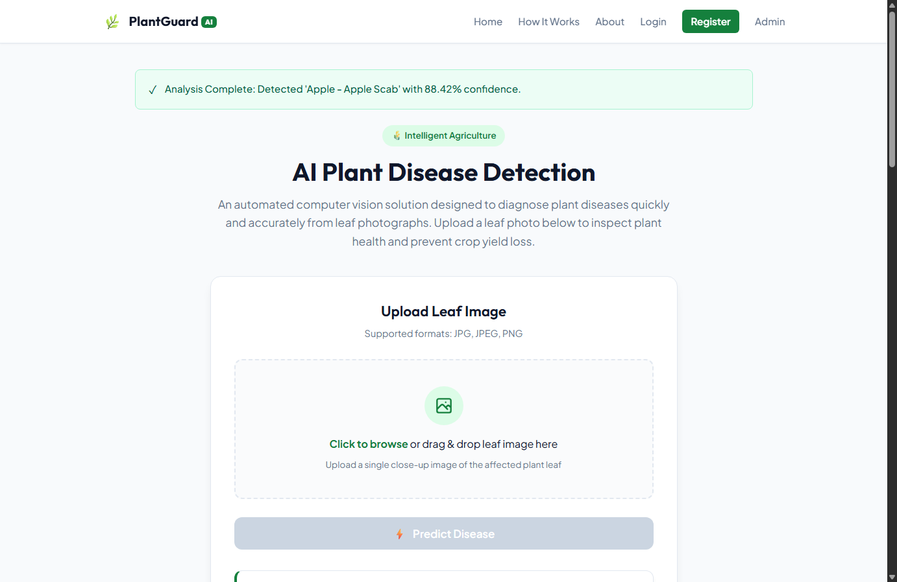
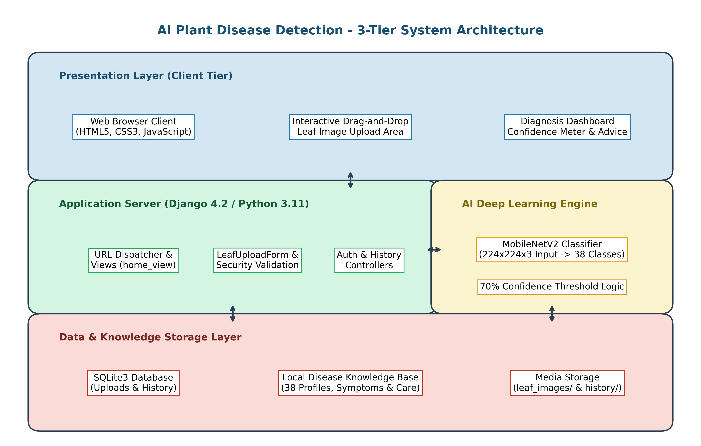

# AI Plant Disease Detection

An automated computer vision and deep learning web application built with Python and Django to classify crop leaf diseases from photographs, provide confidence metrics, and deliver agricultural prevention and management recommendations.

---

## 1. Project Overview

Plant diseases pose a severe threat to global agriculture and food security. The **AI Plant Disease Detection** system provides farmers, students, and agricultural researchers with an accessible tool to identify foliar crop infections early.

By analyzing leaf images with a deep Convolutional Neural Network (MobileNetV2), the platform predicts the disease class, computes prediction confidence, highlights top-3 probable classes, and displays actionable management advice, symptom breakdowns, and prevention guidelines across 38 crop disease and healthy categories.

## Screenshots

| Home page | Prediction result |
| :---: | :---: |
|  |  |



---

## 2. Main Features

- **Leaf Image Upload & Drag-and-Drop**: Interactive UI with instant client-side preview and server-side validation.
- **AI Deep Learning Classification**: Automated inference powered by a fine-tuned MobileNetV2 neural network.
- **Confidence Score & Meter**: Visual probability meter showing the model's certainty.
- **Top-3 Prediction Breakdown**: Secondary candidate predictions for transparent diagnosis.
- **70% Confidence Threshold**: Automatic safety mechanism preventing low-confidence misdiagnoses.
- **Low-Confidence Fallback Handling**: Informative guidance prompting the user to upload clearer images when confidence is below 70%.
- **Comprehensive Disease Knowledge Base**: Local static knowledge base for all 38 supported classes.
- **Symptoms, Causes, and Prevention**: Detailed breakdowns for each disease class.
- **Basic Agricultural Recommendations**: Non-hazardous, practical crop care tips.
- **Academic & Advisory Notice**: Clear safety disclaimer encouraging expert verification.

---

## 3. Technology Stack

- **Backend Framework**: Python 3.11+ & Django 4.2
- **Database**: SQLite3 (Local, zero configuration required)
- **Deep Learning / AI**: TensorFlow 2.15+ & Keras
- **Neural Network Architecture**: MobileNetV2 (Transfer Learning with ImageNet weights)
- **Data & Array Processing**: NumPy
- **Image Processing**: Pillow (PIL)
- **Frontend / UI**: Semantic HTML5, Vanilla CSS3 (Custom responsive styling), Vanilla JavaScript (Drag & drop / preview)

---

## 4. AI Model Architecture & Workflow

- **Base Architecture**: MobileNetV2 pretrained on ImageNet
- **Input Dimensions**: $224 \times 224 \times 3$ RGB images
- **Transfer Learning Strategy**:
  - **Phase 1**: Frozen MobileNetV2 feature extractor + Dense classification head (Global Average Pooling, Dropout 0.3, 38 Softmax outputs).
  - **Phase 2**: Fine-tuning top convolutional layers (from layer 100 onward) with a reduced learning rate ($10^{-5}$) and Early Stopping.
- **Dataset Partitioning**:
  - **Training Set (70%)**: 14,643 images
  - **Validation Set (15%)**: 3,134 images
  - **Unseen Test Set (15%)**: 3,145 images
  - **Data Leakage Check**: Zero image overlap verified across partitions.

---

## 5. Model Evaluation Results

Verified on 3,145 unseen test images:

| Metric | Score |
| :--- | :--- |
| **Test Accuracy** | **95.33%** |
| **Test Loss** | **0.1602** |
| **Macro Precision** | **95.78%** |
| **Macro Recall** | **95.30%** |
| **Macro F1-Score** | **95.39%** |

---

## 6. Confidence Threshold (70%)

The system enforces a strict **70% Confidence Threshold (`0.70`)**:
- **Confidence $\ge$ 70%**: The diagnosis is classified as confident. The system displays the disease name, top-3 candidates, detailed symptom analysis, causes, prevention advice, and basic recommendations.
- **Confidence $<$ 70%**: The diagnosis is flagged as uncertain (`Unable to confidently identify the plant disease`). Disease-specific treatments are hidden to prevent misinformation, and users are guided to provide a clearer photo.

---

## 7. Supported Plant & Disease Classes (38 Classes)

1. Apple — Apple Scab
2. Apple — Black Rot
3. Apple — Cedar Apple Rust
4. Apple — Healthy
5. Blueberry — Healthy
6. Cherry — Healthy
7. Cherry — Powdery Mildew
8. Corn — Common Rust
9. Corn — Gray Leaf Spot
10. Corn — Healthy
11. Corn — Northern Leaf Blight
12. Grape — Black Measles
13. Grape — Black Rot
14. Grape — Healthy
15. Grape — Leaf Blight
16. Orange — Citrus Greening (Huanglongbing)
17. Peach — Bacterial Spot
18. Peach — Healthy
19. Pepper Bell — Bacterial Spot
20. Pepper Bell — Healthy
21. Potato — Early Blight
22. Potato — Healthy
23. Potato — Late Blight
24. Raspberry — Healthy
25. Soybean — Healthy
26. Squash — Powdery Mildew
27. Strawberry — Healthy
28. Strawberry — Leaf Scorch
29. Tomato — Bacterial Spot
30. Tomato — Early Blight
31. Tomato — Healthy
32. Tomato — Late Blight
33. Tomato — Leaf Mold
34. Tomato — Mosaic Virus
35. Tomato — Septoria Leaf Spot
36. Tomato — Spider Mites (Two-spotted spider mite)
37. Tomato — Target Spot
38. Tomato — Yellow Leaf Curl Virus

---

## 8. Project Structure

```text
Plant_Disease/
│── manage.py                                 # Django management script
│── requirements.txt                          # Python dependencies
│── README.md                                 # Project documentation
│── .env.example                              # Safe environment-variable template
│── plant_disease_project/                    # Django configuration
│   ├── settings.py                           # Settings, threshold, & media config
│   ├── urls.py                               # Root URL dispatcher
│   ├── wsgi.py                               # WSGI gateway
│   └── asgi.py                               # ASGI gateway
│── detector/                                 # Detection Django application
│   ├── models.py                             # PlantLeafUpload model
│   ├── forms.py                              # LeafUploadForm with size/type validation
│   ├── views.py                              # Home view & AI integration controller
│   ├── urls.py                               # App URL routing
│   ├── admin.py                              # Django admin configuration
│   └── ai/                                   # AI prediction services
│       ├── predictor.py                      # Singleton inference engine
│       ├── disease_info.py                   # 38-class Knowledge Base
│       └── model/
│           ├── plant_disease_model.keras     # Trained MobileNetV2 model binary
│── datasets/metadata/
│   ├── class_names.json                      # Required 38-class index mapping
│   └── README.md                             # Dataset source and class notes
│── templates/                                # HTML Templates
│   ├── base.html                             # Global layout, navbar, & footer
│   └── detector/
│       └── home.html                         # Home page, upload, & diagnosis cards
│── static/                                   # Static assets
│   ├── css/
│   │   └── style.css                         # Custom styling & responsive layouts
│   └── js/
│       └── main.js                           # Drag-and-drop & preview interactions
│── documentation_assets/                     # Project diagrams, charts, & screenshots
└── training/                                 # Dataset & Model pipeline scripts
    ├── download_datasets.py                  # Step 2 dataset acquisition
    ├── prepare_dataset.py                    # Step 3 dataset splitting & deduplication
    ├── train_model.py                        # Step 4 MobileNetV2 training
    ├── evaluate_model.py                     # Step 5 evaluation & verification
    ├── test_integration.py                   # Step 6 integration test suite
    ├── verify_step7.py                       # Step 7 knowledge base verification
    └── test_step8_final.py                   # Step 8 final end-to-end verification
```

Dataset image folders (`dataset/`, `datasets/raw/`, `datasets/combined/`, and
`datasets/processed/`), the local SQLite database, and uploaded files under
`media/` are local-only and are not included in the repository. The class mapping
in `datasets/metadata/class_names.json` is retained because the application uses
it to map model outputs to disease names.

---

## 9. Installation & Setup

1. **Clone or Navigate to the Workspace**:
   ```bash
   cd Plant_Disease
   ```

2. **Create and Activate a Virtual Environment** (Optional but Recommended):
   - **Windows**:
     ```bash
     python -m venv venv
     venv\Scripts\activate
     ```
   - **Linux / macOS**:
     ```bash
     python3 -m venv venv
     source venv/bin/activate
     ```

3. **Install Dependencies**:
   ```bash
   pip install -r requirements.txt
   ```

4. **Configure Environment Variables**:
   Copy `.env.example` to `.env` in the project root, then set a private Django
   key in `.env`. For example, generate a key with:
   ```bash
   python -c "from django.core.management.utils import get_random_secret_key; print(get_random_secret_key())"
   ```
   Set `DJANGO_DEBUG=True` for local development. Never commit `.env`; it is
   ignored by Git. `.env.example` is a safe template, not a production secret.

5. **Run Database Migrations**:
   ```bash
   python manage.py migrate
   ```

6. **Check the Django Configuration**:
   ```bash
   python manage.py check
   ```

7. **Start the Development Server**:
   ```bash
   python manage.py runserver
   ```

8. **Access the Application**:
   Open your browser and navigate to:
   [http://127.0.0.1:8000/](http://127.0.0.1:8000/)

---

## Dataset Preparation

The image datasets are intentionally not included in this repository. To prepare
data for training, run `python training/download_datasets.py` to download and
combine its configured public sources. The script writes source images and
combined classes under the ignored `datasets/` directory. Then run:

```bash
python training/prepare_dataset.py
python training/train_model.py
python training/evaluate_model.py
```

Dataset source licenses and attribution requirements still apply. The included
trained model can be used without downloading the training datasets.

---

## Usage Instructions

1. Open the homepage at `http://127.0.0.1:8000/`.
2. Click on the upload zone or drag-and-drop a leaf photograph (JPG, JPEG, PNG, or WEBP, max 10MB).
3. Review the instant image preview and click **Predict Disease**.
4. View the diagnosis card:
   - If confidence $\ge$ 70%: Review detected disease name, confidence score, top-3 candidates, symptoms, causes, prevention, and recommendations.
   - If confidence $<$ 70%: Note the uncertainty advisory and upload a clearer, single-leaf image.

---

## Important Academic & Educational Disclaimer

This software is developed strictly for **academic, educational, and research purposes**. The AI model provides automated pattern-matching classifications based on photographic datasets and must not be used as a sole or guaranteed basis for commercial agricultural treatment or chemical pesticide application. Always consult certified agricultural extension officers or agronomists for verified field diagnosis and treatment plans.
